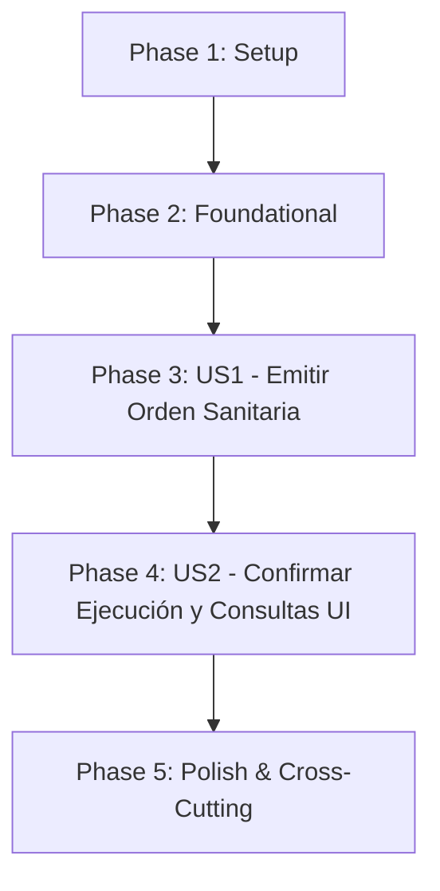

# Implementation Plan: Gestión del Sacrificio Sanitario

**Created**: 05/10/2026

**Last Updated**: 29/10/2026

**Arquitectura y tecnologías**: [General.md](General.md)

**Specs**:

- [012-OrdenarSacrificioSanitario.md](../specs/012-OrdenarSacrificioSanitario.md)

## Summary

Implementar la emisión, la consulta y la confirmación de la ejecución de órdenes de sacrificio sanitario total por parte del personal veterinario, como respuesta de contención biológica ante diagnósticos confirmados de enfermedades mortales en la granja avícola[cite: 5, 19, 22].

El plan asegura la separación estricta entre la orden y su ejecución efectiva: la emisión de la orden no altera la población del lote ni el estado operativo del galpón, manteniéndolo en estado de `AISLAMIENTO` hasta que se confirme la ejecución en campo[cite: 5, 19, 22]. La confirmación de la ejecución opera como una transacción atómica local indivisible que fija en exactamente cero la población viva del lote, transiciona el estado operativo del galpón de `AISLAMIENTO` a `VACIADO_SANITARIO`, marca la orden como `EJECUTADA` (bloqueando cualquier intento de re-confirmación), emite el evento interno `SacrificioSanitarioEjecutadoEvent` para cerrar el diagnóstico en el Plan 015 y registra atómicamente en el Outbox el evento de integración hacia Apache Kafka (con `loteId` como clave de partición) para el Módulo 3[cite: 1, 5, 18, 19, 22].

`Galpon` y `Lote` continúan siendo entidades autoritativas del Módulo 1; el diagnóstico clínico pertenece al [Plan 015](015-DiagnosticoYReintegroSanitario.md) y el catálogo de enfermedades al [Plan 005](005-CatalogoDeEnfermedades.md)[cite: 5, 19]. Este plan orquesta dichas capacidades a través de puertos de salida públicos, sin crear tablas paralelas ni copias de datos ajenos[cite: 5, 19]. La orden de sacrificio sanitario es de alcance total (100 % de las aves alojadas) y no solicita pesajes, cantidades parciales ni liquidaciones económicas comerciales, las cuales corresponden exclusivamente al sacrificio productivo ([Plan 009](009-AptitudProgramacionYResultadosDelSacrificioProductivo.md) y [Plan 016](016-ResultadosDelSacrificioProductivo.md))[cite: 5, 19, 22].

## Technical Context

**Integraciones específicas**: Consulta del diagnóstico clínico y validación del indicador `requiereSacrificioSanitario` del Plan 015 (`DiagnosticoGalponQueryPort`); consulta del estado operativo del galpón y población del lote del Módulo 1 (`GalponQueryPort`, `LoteQueryPort`); solicitud de cambio de estado operativo del galpón (`CambiarEstadoOperativoGalponPort`); vaciado atómico de inventario vivo a cero (`ActualizarInventarioVivoPort`); publicación del evento interno `SacrificioSanitarioEjecutadoEvent` con Spring Modulith (para que el Plan 015 cambie el estado del diagnóstico a `CERRADO_POR_SACRIFICIO`) y publicación confiable del contrato de integración hacia Apache Kafka mediante el registro transaccional de publicaciones (Transactional Outbox) usando `loteId` como Partition Key[cite: 1, 5, 18, 19].

**Datos propios**: Órdenes de sacrificio sanitario (`OrdenSacrificioSanitario`) con control de concurrencia optimista (`@Version`)[cite: 5, 19, 22].

**Performance Goals**:

- El 95 % de las emisiones de órdenes de sacrificio sanitario se procesa y persiste en un tiempo máximo de 1 segundo[cite: 5, 19, 22].
- El 95 % de las confirmaciones de ejecución (incluyendo la actualización atómica del lote a cero, el cambio del galpón a vaciado sanitario, el cierre del diagnóstico y el registro en Outbox) se completa en un tiempo máximo de 1 segundo[cite: 5, 19, 22].
- El 95 % de las consultas de listado y detalle de órdenes responde en máximo 1 segundo[cite: 5, 19].

**Constraints**:

- Acceso y rol exclusivo: tanto la emisión como la confirmación de la ejecución están restringidas exclusivamente al rol `ROLE_VETERINARIO`[cite: 5, 19, 22]. Cualquier intento por parte de trabajadores u otros roles es bloqueado con error `403 Forbidden`[cite: 5, 19, 22]. La consulta (`GET`) está permitida a `ROLE_VETERINARIO` y `ROLE_ADMINISTRADOR`[cite: 5, 19, 22].
- Condición diagnóstica obligatoria: la orden solo procede si existe un diagnóstico confirmado en el galpón cuyo indicador `requiereSacrificioSanitario` sea estrictamente `true`[cite: 5, 19, 22].
- Estado del galpón: el galpón debe encontrarse obligatoriamente en estado `AISLAMIENTO` al momento de emitir la orden y debe permanecer en dicho estado hasta que se confirme su ejecución[cite: 5, 19, 22].
- Condición del lote: el lote activo debe contar con una población viva actual mayor que cero (`poblacionActual > 0`) tanto en la emisión como en la confirmación[cite: 5, 19, 22].
- Alcance total obligatorio: la orden abarca invariablemente a toda la población del lote alojado; el sistema no solicita ni permite ingresar una cantidad parcial de aves a sacrificar[cite: 5, 19, 22].
- No alteración anticipada: una orden emitida en estado `PENDIENTE_EJECUCION` no modifica la población del lote ni el estado del galpón[cite: 5, 19, 22].
- Atomicidad y Rollback en la ejecución: la confirmación debe establecer la población en cero, cambiar el galpón a `VACIADO_SANITARIO`, marcar la orden como `EJECUTADA`, publicar el evento interno para cerrar el diagnóstico (`CERRADO_POR_SACRIFICIO`) y registrar el evento de integración en el Outbox dentro de una única transacción local indivisible (`@Transactional`)[cite: 5, 19, 22]. Si el Módulo 1 falla o no responde, se revierte toda la operación (_rollback_)[cite: 10, 22].
- Idempotencia, concurrencia e inmutabilidad: tanto la emisión (`POST /ordenes-sacrificio-sanitario`) como la confirmación de ejecución (`POST /ejecucion`) exigen explícitamente la cabecera `X-Idempotency-Key` y la entidad aplica `@Version`[cite: 10, 22]. Una orden ejecutada no puede volver a confirmarse ni editarse (`409 Conflict`), y se prohíbe el borrado físico (`DELETE`)[cite: 5, 10, 19, 22].
- Formato de errores RFC 9457: todas las respuestas ante inconsistencias o fallas utilizan `application/problem+json`[cite: 1, 5, 18, 19].

**Scale/Scope**: Dos historias de usuario principales más consulta filtrable para UI, cuatro endpoints REST, una entidad raíz con su máquina de estados y control `@Version`, puertos de salida con respaldo autónomo (_fallback_) para entorno local, evento interno hacia Plan 015 y publicación Outbox hacia Kafka[cite: 5, 19].

**Dependencias funcionales**:

- Diagnósticos clínicos del [Plan 015](015-DiagnosticoYReintegroSanitario.md) y catálogo de enfermedades del [Plan 005](005-CatalogoDeEnfermedades.md)[cite: 5, 19].
- Consulta y mutación de galpones y lotes del Módulo 1 / [Plan 001](001-ConsultaDeGalpones.md) (`GalponQueryPort`, `LoteQueryPort`, `CambiarEstadoOperativoGalponPort` y `ActualizarInventarioVivoPort`)[cite: 5, 19].
- Autenticación, actor autenticado, reloj compartido, idempotencia y formato de errores definidos en [General.md](General.md)[cite: 1, 5, 18, 19].

### Decisiones específicas

1. **Entidad, Enriquecimiento UX y Ciclo de Vida de la Orden**:
   - `OrdenSacrificioSanitario` es la entidad raíz de este subdominio[cite: 5, 19]. Contiene `id` (`UUID`), `diagnosticoId`, `galponId`, `loteId`, `enfermedadNombreHistorico`, `poblacionAfectadaMomento` (aves vivas al emitir), `poblacionSacrificada` (aves vivas realmente extinguidas al confirmar, opcional hasta ejecutar), `motivoClinico`, `emitidaPor`, `emitidaEn`, `ejecutadaPor` (opcional), `ejecutadaEn` (opcional), `observacionesEjecucion` (opcional), `estado` (`PENDIENTE_EJECUCION`, `EJECUTADA`) y `version` (`@Version`)[cite: 5, 10, 19, 22].
2. **Unicidad de Orden Activa por Galpón**:
   No se permite emitir una segunda orden de sacrificio sanitario si ya existe una orden previa en estado `PENDIENTE_EJECUCION` para el mismo galpón[cite: 5, 19, 22]. Se protege tanto en dominio como mediante un índice único parcial en PostgreSQL (`WHERE estado = 'PENDIENTE_EJECUCION'`).
3. **Validación Diagnóstica en Tiempo Real**:
   Al momento de solicitar la emisión, el caso de uso consulta `DiagnosticoGalponQueryPort` para certificar que el diagnóstico existe, corresponde al galpón evaluado y su enfermedad tiene activado el indicador booleano `requiereSacrificioSanitario == true`[cite: 5, 19, 22]. Si el indicador es falso, la operación se rechaza con código `409 Conflict`[cite: 5, 19, 22].
4. **Verificación del Estado de Aislamiento y Población Viva**:
   Tanto en la emisión como en la confirmación, el galpón debe encontrarse en estado `AISLAMIENTO` y el lote alojado debe tener `poblacionActual > 0`[cite: 5, 19, 22]. Si entre la emisión y la confirmación la población disminuyó por mortalidad natural (pero sigue siendo `> 0`), la confirmación toma el saldo vivo remanente como `poblacionSacrificada` y lo fija en `0`[cite: 9, 10, 22].
5. **Transición Atómica de Ejecución y Rollback**:
   Al invocar `ConfirmarEjecucionSacrificioSanitarioUseCase`, se ejecuta una transacción local (`@Transactional`) que:
   - Valida que la orden continúe en estado `PENDIENTE_EJECUCION` y verifica su `@Version`[cite: 5, 10, 19, 22].
   - Consulta el galpón (`AISLAMIENTO`) y bloquea el lote activo para verificar que aún tenga aves vivas (`poblacionActual > 0`)[cite: 5, 19, 22].
   - Invoca `ActualizarInventarioVivoPort.fijarPoblacionEnCero(loteId)` para extinguir el inventario vivo del lote[cite: 5, 19].
   - Invoca `CambiarEstadoOperativoGalponPort.cambiarEstado(galponId, AISLAMIENTO, VACIADO_SANITARIO)`[cite: 5, 19].
   - Actualiza la orden a estado `EJECUTADA`, registrando `poblacionSacrificada`, el veterinario confirmante (`ejecutadaPor`) y el instante UTC (`ejecutadaEn`)[cite: 5, 10, 19].
   - Publica el evento interno `SacrificioSanitarioEjecutadoEvent` (consumido por el Plan 015 dentro del límite transaccional para cambiar el estado del diagnóstico a `CERRADO_POR_SACRIFICIO`) y registra el evento de integración en el Outbox de Spring Modulith[cite: 1, 5, 18, 19]. Si cualquiera de los pasos anteriores lanza excepción, toda la transacción hace _rollback_[cite: 10, 22].
6. **Eventos (Spring Modulith + Outbox hacia Kafka con Partition Key `loteId`)**:
   - Se elimina la publicación de eventos en la emisión (`PENDIENTE_EJECUCION`) para evitar sobre-ingeniería sin consumidores (YAGNI).
   - **Evento Interno (Spring Modulith)**: `SacrificioSanitarioEjecutadoEvent` (incluye `ordenId`, `diagnosticoId`, `galponId`, `loteId`, `poblacionSacrificada`, `ejecutadaPor`, `ejecutadaEn`)[cite: 5, 19]. El Plan 015 escucha este evento para marcar el diagnóstico clínico como `CERRADO_POR_SACRIFICIO`, garantizando consistencia transaccional e impidiendo cualquier reintegro futuro.
   - **Evento de Integración (Apache Kafka)**: `AviControl.Sanitario.SacrificioSanitarioEjecutado.v1`[cite: 5, 19]. Se registra atómicamente en el Outbox y, tras el _commit_ local, se publica en Kafka utilizando **`loteId` como clave de partición (`partitionKey = loteId.toString()`)**, conforme a [General.md](General.md), para que el Módulo 3 (Finanzas) procese en orden estricto todos los eventos de costos y la baja contable integral del lote sin ingresos por venta[cite: 1, 5, 18, 19].
7. **Autonomía UX/UI y Adaptadores con Respaldo (_Fallback_)**:
   - Se expone `GET /api/ordenes-sacrificio-sanitario` con filtros opcionales `?galponId=uuid&estado=PENDIENTE_EJECUCION|EJECUTADA` además de `GET /api/ordenes-sacrificio-sanitario/{ordenId}`, devolviendo los nombres de galpón, lote y enfermedad para que el frontend liste y confirme órdenes sin adivinar UUIDs.
   - Los adaptadores hacia el Módulo 1 y el Plan 015 cuentan con configuración de respaldo (_fallback/seed_) para pruebas locales autónomas sin bloquear el despliegue del equipo veterinario.
8. **Persistencia y Migraciones**:
   Flyway creará la tabla `orden_sacrificio_sanitario` utilizando la siguiente versión disponible del repositorio (sin fijar un número estático que colisione con otras ramas), prohibiendo el borrado físico (`DELETE`)[cite: 1, 10, 18, 22].

### Alcance documental

- La solicitud y validación de aislamiento corresponden al [Plan 014](014-SolicitudesYValidacionDeAislamiento.md); la confirmación del diagnóstico y su posterior cierre por sacrificio (`CERRADO_POR_SACRIFICIO`) corresponden al [Plan 015](015-DiagnosticoYReintegroSanitario.md)[cite: 5, 19].
- La aptitud, programación y ejecución del sacrificio comercial por cumplimiento del ciclo de engorde (edad $\ge 45$ días) corresponden al [Plan 009](009-AptitudProgramacionYResultadosDelSacrificioProductivo.md); el registro de peso y cantidad final comercial corresponde al [Plan 016](016-ResultadosDelSacrificioProductivo.md)[cite: 5, 19].

## Project Structure

### Documentation (this feature)

```text
docs/
├── specs/
│   └── 012-OrdenarSacrificioSanitario.md
└── plan/
    └── 008-GestionDelSacrificioSanitario.md
```

### Source Code (repository root)

```text
src/main/java/com/avicontrol/
├── domain/
│   ├── model/sanitario/sacrificio/
│   │   ├── OrdenSacrificioSanitario.java
│   │   └── EstadoOrdenSanitaria.java
│   ├── event/sanitario/sacrificio/
│   │   └── SacrificioSanitarioEjecutadoEvent.java
│   ├── exception/sanitario/sacrificio/
│   │   ├── OrdenSacrificioSanitarioNoEncontradaException.java
│   │   ├── OrdenSacrificioPendienteDuplicadaException.java
│   │   ├── DiagnosticoNoRequiereSacrificioException.java
│   │   ├── GalponNoEstaEnAislamientoException.java
│   │   ├── LoteSinPoblacionVivaException.java
│   │   └── OrdenSacrificioYaEjecutadaException.java
│   └── port/out/sanitario/sacrificio/
│       ├── OrdenSacrificioSanitarioRepositoryPort.java
│       ├── DiagnosticoGalponQueryPort.java
│       ├── GalponQueryPort.java
│       ├── LoteQueryPort.java
│       ├── CambiarEstadoOperativoGalponPort.java
│       ├── ActualizarInventarioVivoPort.java
│       └── IntegrationEventPublisherPort.java
├── application/sanitario/sacrificio/
│   ├── EmitirOrdenSacrificioSanitarioUseCase.java
│   ├── ConfirmarEjecucionSacrificioSanitarioUseCase.java
│   ├── ConsultarOrdenSacrificioSanitarioUseCase.java
│   ├── command/
│   │   ├── EmitirOrdenSacrificioSanitarioCommand.java
│   │   └── ConfirmarEjecucionSacrificioSanitarioCommand.java
│   └── result/
│       └── OrdenSacrificioSanitarioResult.java
└── infrastructure/
    ├── adapter/in/rest/sanitario/sacrificio/
    │   ├── OrdenSacrificioSanitarioController.java
    │   ├── dto/
    │   │   ├── EmitirOrdenSacrificioSanitarioRequest.java
    │   │   ├── ConfirmarEjecucionSacrificioSanitarioRequest.java
    │   │   └── OrdenSacrificioSanitarioResponse.java
    │   └── mapper/OrdenSacrificioSanitarioRestMapper.java
    ├── adapter/out/
    │   ├── persistence/sanitario/sacrificio/
    │   │   ├── entity/OrdenSacrificioSanitarioEntity.java
    │   │   ├── repository/SpringDataOrdenSacrificioSanitarioRepository.java
    │   │   ├── mapper/OrdenSacrificioSanitarioPersistenceMapper.java
    │   │   └── OrdenSacrificioSanitarioPersistenceAdapter.java
    │   ├── event/sanitario/sacrificio/
    │   │   ├── SacrificioSanitarioKafkaPublisherAdapter.java
    │   │   └── payload/SacrificioSanitarioEjecutadoV1Payload.java
    │   └── internal/sanitario/sacrificio/
    │       ├── DiagnosticoGalponQueryAdapter.java
    │       └── Modulo1SacrificioSanitarioAdapter.java
    └── config/
        └── SacrificioSanitarioBeanConfiguration.java

src/test/java/com/avicontrol/
├── domain/model/sanitario/sacrificio/
│   └── OrdenSacrificioSanitarioTest.java
├── application/sanitario/sacrificio/
│   ├── EmitirOrdenSacrificioSanitarioUseCaseTest.java
│   ├── ConfirmarEjecucionSacrificioSanitarioUseCaseTest.java
│   └── ConsultarOrdenSacrificioSanitarioUseCaseTest.java
└── infrastructure/
    ├── adapter/in/rest/sanitario/sacrificio/
    │   └── OrdenSacrificioSanitarioControllerTest.java
    ├── adapter/out/persistence/sanitario/sacrificio/
    │   └── OrdenSacrificioSanitarioPersistenceAdapterTest.java
    └── integration/sanitario/sacrificio/
        └── SacrificioSanitarioFlowIntegrationTest.java
```

**Structure Decision**: Arquitectura hexagonal modular en Java 21 / Spring Boot 4[cite: 1, 5, 18, 19]. Dominio puro libre de frameworks; casos de uso transaccionales que orquestan las validaciones diagnósticas y operativas; publicación de evento interno en memoria hacia Plan 015 y publicación confiable a Kafka mediante el registro Outbox de Spring Modulith tras confirmar la transacción local[cite: 1, 5, 18, 19].

### Entidades y relación

```text
OrdenSacrificioSanitario (Aggregate Root)
├── id: UUID
├── diagnosticoId: UUID
├── galponId: UUID
├── loteId: UUID
├── enfermedadNombreHistorico: String
├── poblacionAfectadaMomento: Integer (> 0, capturada al emitir)
├── poblacionSacrificada: Integer (opcional al emitir; > 0 capturada al confirmar ejecución)
├── motivoClinico: String
├── emitidaPor: UUID
├── emitidaEn: Instant
├── ejecutadaPor: UUID (opcional)
├── ejecutadaEn: Instant (opcional)
├── observacionesEjecucion: String (opcional)
├── estado: EstadoOrdenSanitaria (PENDIENTE_EJECUCION, EJECUTADA)
└── version: Integer (@Version para Optimistic Locking)
```

Relaciones:

- La orden se vincula de forma unívoca a un `DiagnosticoGalpon` del Plan 015 cuya enfermedad exige sacrificio sanitario (`requiereSacrificioSanitario == true`)[cite: 5, 19].
- Referencia al `Galpon` en estado `AISLAMIENTO` y al `Lote` activo con aves vivas alojadas[cite: 5, 19].
- La confirmación transiciona la orden a `EJECUTADA`, pone a `0` la población del `Lote`, pasa el `Galpon` a `VACIADO_SANITARIO` y desencadena el cambio del `DiagnosticoGalpon` a `CERRADO_POR_SACRIFICIO` en el Plan 015[cite: 5, 19].

### Contratos de los puertos

| Puerto                                   | Tipo                              | Responsabilidad                                                                                                                                                                                                                                                   |
| ---------------------------------------- | --------------------------------- | ----------------------------------------------------------------------------------------------------------------------------------------------------------------------------------------------------------------------------------------------------------------- |
| `OrdenSacrificioSanitarioRepositoryPort` | Salida (Persistencia)             | Guardar y actualizar órdenes con control `@Version`, buscar por UUID, listar por `galponId`/`estado` y verificar órdenes pendientes activas por galpón[cite: 5, 19].                                                                                              |
| `DiagnosticoGalponQueryPort`             | Salida (Integración Plan 015)     | Consultar existencia del diagnóstico, verificar que pertenezca al galpón, obtener el nombre de la enfermedad y validar `requiereSacrificioSanitario == true`[cite: 5, 19].                                                                                        |
| `GalponQueryPort`                        | Salida (Integración Módulo 1)     | Verificar que el galpón exista, obtener su nombre y comprobar que su estado vigente sea `AISLAMIENTO`[cite: 5, 19].                                                                                                                                               |
| `LoteQueryPort`                          | Salida (Integración Módulo 1)     | Verificar el lote activo alojado, su nombre/código y comprobar que `poblacionActual > 0`[cite: 5, 19].                                                                                                                                                            |
| `CambiarEstadoOperativoGalponPort`       | Salida (Integración Módulo 1)     | Ejecutar la transición atómica del galpón de `AISLAMIENTO` a `VACIADO_SANITARIO`[cite: 5, 19].                                                                                                                                                                    |
| `ActualizarInventarioVivoPort`           | Salida (Integración Módulo 1)     | Fijar en exactamente cero (`poblacionActual = 0`) la población viva del lote activo[cite: 5, 19].                                                                                                                                                                 |
| `IntegrationEventPublisherPort`          | Salida (Eventos / Outbox / Kafka) | Publicar `SacrificioSanitarioEjecutadoEvent` en Spring Modulith (para cerrar el diagnóstico en Plan 015) y registrar en el Outbox el contrato `AviControl.Sanitario.SacrificioSanitarioEjecutado.v1` hacia Kafka con `partitionKey = loteId`[cite: 1, 5, 18, 19]. |

### Contratos HTTP propuestos

| Método y ruta                                                | Acceso                                   | Parámetros / Cabeceras                                              | Propósito                                                                                                                                                         |
| ------------------------------------------------------------ | ---------------------------------------- | ------------------------------------------------------------------- | ----------------------------------------------------------------------------------------------------------------------------------------------------------------- |
| `POST /api/galpones/{galponId}/ordenes-sacrificio-sanitario` | `ROLE_VETERINARIO`                       | Header obligatorio: `X-Idempotency-Key`                             | Emitir orden de sacrificio sanitario total en estado `PENDIENTE_EJECUCION`[cite: 5, 19, 22].                                                                      |
| `POST /api/ordenes-sacrificio-sanitario/{ordenId}/ejecucion` | `ROLE_VETERINARIO`                       | Header obligatorio: `X-Idempotency-Key`                             | Confirmar la ejecución física atómica: población a cero, galpón a `VACIADO_SANITARIO`, diagnóstico `CERRADO_POR_SACRIFICIO` y orden `EJECUTADA`[cite: 5, 19, 22]. |
| `GET /api/ordenes-sacrificio-sanitario`                      | `ROLE_VETERINARIO`, `ROLE_ADMINISTRADOR` | Query (opc): `?galponId=uuid&estado=PENDIENTE_EJECUCION\|EJECUTADA` | Listar órdenes de sacrificio sanitario con datos enriquecidos para la interfaz.                                                                                   |
| `GET /api/ordenes-sacrificio-sanitario/{ordenId}`            | `ROLE_VETERINARIO`, `ROLE_ADMINISTRADOR` | Path: `ordenId`                                                     | Consultar el detalle y estado de una orden de sacrificio sanitario específica[cite: 5, 19, 22].                                                                   |

### JSON común de errores

Siguiendo RFC 9457 y [General.md](General.md)[cite: 1, 5, 18, 19]:

```json
{
  "type": "https://avicontrol/errors/galpon-no-en-aislamiento",
  "title": "Conflicto en emisión de sacrificio sanitario",
  "status": 409,
  "detail": "El galpón 550e8400-e29b-41d4-a716-446655440001 debe encontrarse en estado AISLAMIENTO (estado actual: PRODUCTIVO)",
  "instance": "/api/galpones/550e8400-e29b-41d4-a716-446655440001/ordenes-sacrificio-sanitario",
  "code": "GALPON_NO_ESTA_EN_AISLAMIENTO",
  "correlationId": "f4b07384-e113-4a1a-bb02-885b058c672b",
  "fieldErrors": []
}
```

---

## Phase 1: Setup (Shared Infrastructure)

**Purpose**: Preparar configuraciones de seguridad, fixtures autónomos y contratos de comunicación interna y externa[cite: 5, 19].

- [ ] T001 Revisar el contrato de `DiagnosticoGalponQueryPort` y el listener de `SacrificioSanitarioEjecutadoEvent` con el Plan 015 para asegurar la lectura de `requiereSacrificioHistorico` y el cierre del diagnóstico (`CERRADO_POR_SACRIFICIO`) al ejecutarse el sacrificio[cite: 5, 19].
- [ ] T002 Verificar los contratos de `CambiarEstadoOperativoGalponPort` y `ActualizarInventarioVivoPort` con el Módulo 1 (incluyendo adaptador con respaldo autónomo para pruebas locales)[cite: 5, 19].
- [ ] T003 Configurar en Spring Security la restricción de acceso estricta para `ROLE_VETERINARIO` en escrituras (`POST`) y `ROLE_VETERINARIO` / `ROLE_ADMINISTRADOR` en consultas (`GET`)[cite: 5, 19].
- [ ] T004 Crear fixtures de pruebas: galpón en aislamiento con lote activo, galpón en producción, diagnóstico tratable (sin sacrificio), diagnóstico mortal con sacrificio requerido y órdenes en estado pendiente y ejecutada[cite: 5, 19].

**Checkpoint**: Contratos, seguridad y adaptadores desacoplados listos sin ambigüedades[cite: 5, 19].

---

## Phase 2: Foundational (Blocking Prerequisites)

**Purpose**: Construir entidades de dominio, excepciones, migración Flyway y adaptadores de persistencia y Outbox/Kafka[cite: 5, 19].

- [ ] T005 Implementar en Java puro la entidad `OrdenSacrificioSanitario` (incluyendo `version`, `poblacionAfectadaMomento`, `poblacionSacrificada` y normalización `trim()`) y el enum `EstadoOrdenSanitaria` (`PENDIENTE_EJECUCION`, `EJECUTADA`)[cite: 5, 19].
- [ ] T006 Implementar las excepciones de negocio: `OrdenSacrificioSanitarioNoEncontradaException`, `OrdenSacrificioPendienteDuplicadaException`, `DiagnosticoNoRequiereSacrificioException`, `GalponNoEstaEnAislamientoException`, `LoteSinPoblacionVivaException` y `OrdenSacrificioYaEjecutadaException`[cite: 5, 19].
- [ ] T007 Definir las interfaces de salida `OrdenSacrificioSanitarioRepositoryPort`, `DiagnosticoGalponQueryPort`, `GalponQueryPort`, `LoteQueryPort`, `CambiarEstadoOperativoGalponPort`, `ActualizarInventarioVivoPort` e `IntegrationEventPublisherPort`[cite: 5, 19].
- [ ] T008 Crear la migración Flyway usando la siguiente versión disponible del repositorio para la tabla `orden_sacrificio_sanitario`, incluyendo columna `version`, índices por `galpon_id`, `lote_id`, `diagnostico_id`, `estado` y restricción única parcial para impedir dos órdenes en `PENDIENTE_EJECUCION` sobre el mismo `galpon_id`.
- [ ] T009 Implementar `OrdenSacrificioSanitarioEntity`, `SpringDataOrdenSacrificioSanitarioRepository`, `OrdenSacrificioSanitarioPersistenceMapper` y `OrdenSacrificioSanitarioPersistenceAdapter` con soporte `@Version` y sin borrado físico[cite: 5, 19, 22].
- [ ] T010 Implementar `SacrificioSanitarioKafkaPublisherAdapter` utilizando el registro de publicaciones de Spring Modulith (Transactional Outbox) para despachar el evento a Kafka con `partitionKey = loteId.toString()` únicamente tras confirmar la transacción local[cite: 1, 5, 18, 19].
- [ ] T011 Configurar la composición de beans en `SacrificioSanitarioBeanConfiguration` y el soporte transaccional `@Transactional`[cite: 5, 19].

**Checkpoint**: Infraestructura base de dominio, persistencia versionada y Outbox lista para soportar las historias de usuario[cite: 5, 19].

---

## Phase 3: User Story 1 — Emitir una Orden de Sacrificio Sanitario Total (Priority: P1)

**Spec**: [012-OrdenarSacrificioSanitario.md](../specs/012-OrdenarSacrificioSanitario.md), historia 1[cite: 5, 19].

**Goal**: El veterinario emite una orden de sacrificio sanitario total respaldada en un diagnóstico confirmado cuya enfermedad requiere dicha medida, quedando asociada al galpón en aislamiento y al lote activo, en estado `PENDIENTE_EJECUCION` y sin alterar aún al galpón ni al lote[cite: 5, 19, 22].

**Independent Test**: Invocar la emisión sobre un galpón en `AISLAMIENTO` con lote de 3.500 aves y diagnóstico con sacrificio requerido; verificar que se cree la orden con estado `PENDIENTE_EJECUCION`, que abarque las 3.500 aves sin haber pedido una cantidad parcial, y que el lote y galpón permanezcan intactos[cite: 5, 19, 22]. Intentar emitir una segunda orden pendiente para el mismo galpón, sin rol de veterinario o con enfermedad tratable y comprobar el rechazo[cite: 5, 19, 22].

### Definición del endpoint REST para User Story 1

| Elemento       | Definición                                                                                                                                                                                                                                                                                                |
| -------------- | --------------------------------------------------------------------------------------------------------------------------------------------------------------------------------------------------------------------------------------------------------------------------------------------------------- |
| Método y ruta  | `POST /api/galpones/{galponId}/ordenes-sacrificio-sanitario`[cite: 5, 19]                                                                                                                                                                                                                                 |
| Autorización   | `ROLE_VETERINARIO`[cite: 5, 19]                                                                                                                                                                                                                                                                           |
| Cabeceras      | `X-Idempotency-Key` (obligatoria para prevenir duplicados por reintentos de red)[cite: 10, 22]                                                                                                                                                                                                            |
| Entrada (Path) | `galponId` (`UUID` obligatorio)[cite: 5, 19]                                                                                                                                                                                                                                                              |
| Entrada (Body) | `diagnosticoId` (`UUID` obligatorio), `motivoClinico` (`String` obligatorio no vacío)[cite: 5, 19]                                                                                                                                                                                                        |
| Respuesta 201  | `OrdenSacrificioSanitarioResponse` con estado `PENDIENTE_EJECUCION`, datos enriquecidos y `version: 1`[cite: 5, 19]                                                                                                                                                                                       |
| Errores        | `400` por datos ausentes o vacíos; `401` sin autenticación; `403` para usuarios no veterinarios; `404` si el galpón o diagnóstico no existen; `409` si la enfermedad no requiere sacrificio, si el galpón no está en aislamiento, si la población es cero o si ya existe orden pendiente[cite: 5, 19, 22] |

#### JSON de solicitud (Request)

```json
{
  "diagnosticoId": "b1a2c3d4-e5f6-7a8b-9c0d-1e2f3a4b5c6d",
  "motivoClinico": "Brote agudo confirmado de Influenza Aviar de alta patogenicidad. Disposición sanitaria urgente."
}
```

#### JSON de respuesta exitosa (Response 201)

```json
{
  "id": "9c8e7d6c-5b4a-3f2e-1d0c-9b8a7f6e5d4c",
  "diagnosticoId": "b1a2c3d4-e5f6-7a8b-9c0d-1e2f3a4b5c6d",
  "galponId": "550e8400-e29b-41d4-a716-446655440001",
  "galponNombre": "Galpón 3",
  "loteId": "2fc03a21-84c4-4c83-bb15-6607bb75cb90",
  "loteNombre": "LDP-003",
  "enfermedadNombre": "Influenza Aviar",
  "poblacionAfectadaMomento": 3500,
  "poblacionSacrificada": null,
  "motivoClinico": "Brote agudo confirmado de Influenza Aviar de alta patogenicidad. Disposición sanitaria urgente.",
  "estado": "PENDIENTE_EJECUCION",
  "emitidaPor": "a1b2c3d4-e5f6-7a8b-9c0d-1e2f3a4b5c6d",
  "emitidaEn": "2026-10-05T14:30:00Z",
  "version": 1
}
```

### Tests para User Story 1

- [ ] T012 [P] [US1] Unit test en `OrdenSacrificioSanitarioTest`: verificar validación de invariantes, normalización `trim()`, estado inicial `PENDIENTE_EJECUCION` y campos obligatorios[cite: 5, 19].
- [ ] T013 [P] [US1] Unit test en `EmitirOrdenSacrificioSanitarioUseCaseTest`: verificar comprobación del diagnóstico con `requiereSacrificioSanitario = true`, galpón en `AISLAMIENTO`, rechazo ante enfermedad no mortal, rechazo ante lote con población cero y rechazo de orden pendiente duplicada[cite: 5, 19, 22].
- [ ] T014 [P] [US1] Contract test en `OrdenSacrificioSanitarioControllerTest`: verificar respuestas HTTP `201`, idempotencia con `X-Idempotency-Key`, `403` para operarios/administradores y `409` ante condiciones diagnósticas u operativas incompatibles[cite: 5, 19, 22].

### Implementación para User Story 1

- [ ] T015 [P] [US1] Implementar DTOs `EmitirOrdenSacrificioSanitarioRequest`, `OrdenSacrificioSanitarioResponse` y mapper `OrdenSacrificioSanitarioRestMapper`[cite: 5, 19].
- [ ] T016 [P] [US1] Implementar `EmitirOrdenSacrificioSanitarioUseCase` coordinando consultas a `DiagnosticoGalponQueryPort`, `GalponQueryPort` y `LoteQueryPort`, y persistiendo la orden pendiente sin alterar el lote ni el galpón[cite: 5, 19].
- [ ] T017 [US1] Implementar endpoint `POST /api/galpones/{galponId}/ordenes-sacrificio-sanitario` en `OrdenSacrificioSanitarioController`[cite: 5, 19].

**Checkpoint**: Emisión de órdenes sanitarias totales operando bajo control veterinario estricto sin mutaciones anticipadas[cite: 5, 19].

---

## Phase 4: User Story 2 — Confirmar la Ejecución y Consultar Órdenes de Sacrificio Sanitario (Priority: P2)

**Spec**: [012-OrdenarSacrificioSanitario.md](../specs/012-OrdenarSacrificioSanitario.md), historia 2 y FR-002[cite: 5, 19, 22].

**Goal**: El veterinario consulta las órdenes de sacrificio sanitario (por galpón, estado o ID) y confirma que una orden pendiente fue ejecutada en campo, lo que extingue a cero la población viva remanente del lote, pasa el galpón a `VACIADO_SANITARIO`, marca la orden como `EJECUTADA`, cierra el diagnóstico en el Plan 015 (`CERRADO_POR_SACRIFICIO`) y registra el evento Outbox para el Módulo 3 de forma atómica e irreversible[cite: 5, 19, 22].

**Independent Test**: Confirmar una orden pendiente donde la población actual es de 3.480 aves; verificar que `poblacionActual` del lote pase a `0`, que el galpón transicione a `VACIADO_SANITARIO`, que la orden pase a `EJECUTADA` con `poblacionSacrificada = 3480`, que el diagnóstico en Plan 015 pase a `CERRADO_POR_SACRIFICIO`, que se persista el evento en Outbox con `partitionKey = loteId` y que un segundo intento de confirmación sea rechazado con `409 Conflict`[cite: 1, 5, 18, 19, 22]. Simular fallo en el puerto del Módulo 1 y comprobar el _rollback_ total de la orden y del Outbox[cite: 10, 22].

### Definición de los eventos para User Story 2

1. **Evento Interno (Spring Modulith)**: `SacrificioSanitarioEjecutadoEvent`
   - Atributos: `eventId`, `ordenId`, `diagnosticoId`, `galponId`, `loteId`, `poblacionSacrificada`, `ejecutadaPor`, `ejecutadaEn`[cite: 5, 19].
   - Consumidor interno: El [Plan 015](015-DiagnosticoYReintegroSanitario.md) escucha este evento dentro de la misma transacción para actualizar el estado del diagnóstico clínico a `CERRADO_POR_SACRIFICIO`.
2. **Evento de Integración (Outbox -> Apache Kafka)**: `AviControl.Sanitario.SacrificioSanitarioEjecutado.v1`[cite: 5, 19]
   - **Partition Key en Kafka**: `loteId` (garantiza que el Módulo 3 procese en orden estricto todos los eventos de costos y bajas asociados al mismo lote)[cite: 1, 18].
   - Estructura conforme a [General.md](General.md): `eventId`, `eventType`, `eventVersion` (`"v1"`), `occurredAt`, `publishedAt`, `producer`, `correlationId`, `causationId`, `aggregateType` (`"Lote"` / `"OrdenSacrificioSanitario"`), `aggregateId` (`ordenId`) y `payload` (`ordenId`, `diagnosticoId`, `galponId`, `loteId`, `enfermedadNombre`, `poblacionSacrificada`, `ejecutadaPor`, `ejecutadaEn`)[cite: 1, 5, 18, 19].
   - Se registra dentro de la misma transacción local `@Transactional` en la tabla de publicaciones de Spring Modulith y se despacha a Kafka después del _commit_[cite: 1, 5, 18, 19].

### Definición de endpoints REST para User Story 2 y Consultas UI

| Elemento       | Definición                                                                                                                                                                                                                                                                                             |
| -------------- | ------------------------------------------------------------------------------------------------------------------------------------------------------------------------------------------------------------------------------------------------------------------------------------------------------ |
| Método y ruta  | `POST /api/ordenes-sacrificio-sanitario/{ordenId}/ejecucion`[cite: 5, 19]                                                                                                                                                                                                                              |
| Autorización   | `ROLE_VETERINARIO`[cite: 5, 19]                                                                                                                                                                                                                                                                        |
| Cabeceras      | `X-Idempotency-Key` (obligatoria para impedir doble ejecución por reintentos de red o doble clic)[cite: 10, 22]                                                                                                                                                                                        |
| Entrada (Path) | `ordenId` (`UUID` obligatorio)[cite: 5, 19]                                                                                                                                                                                                                                                            |
| Entrada (Body) | `observacionesEjecucion` (`String` opcional), `version` (`Integer` obligatorio para control de concurrencia optimista)[cite: 5, 19, 22]                                                                                                                                                                |
| Respuesta 200  | `OrdenSacrificioSanitarioResponse` con estado `EJECUTADA`, `poblacionSacrificada`, fecha y veterinario ejecutor[cite: 5, 19]                                                                                                                                                                           |
| Errores        | `401` sin autenticación; `403` para usuarios no veterinarios; `404` si la orden no existe; `409` si la orden ya fue ejecutada, colisión de `@Version`, el galpón ya no está en aislamiento o la población ya es cero; `503` con _rollback_ completo si el Módulo 1 no está disponible[cite: 5, 19, 22] |

| Elemento      | Definición                                                                                                                              |
| ------------- | --------------------------------------------------------------------------------------------------------------------------------------- |
| Método y ruta | `GET /api/ordenes-sacrificio-sanitario` y `GET /api/ordenes-sacrificio-sanitario/{ordenId}`[cite: 5, 19]                                |
| Autorización  | `ROLE_VETERINARIO`, `ROLE_ADMINISTRADOR`[cite: 5, 19]                                                                                   |
| Parámetros    | En listado: query params opcionales `?galponId=uuid&estado=PENDIENTE_EJECUCION\|EJECUTADA`. En detalle: `ordenId` en ruta[cite: 5, 19]. |
| Respuesta 200 | Lista o detalle de `OrdenSacrificioSanitarioResponse` enriquecido con `galponNombre`, `loteNombre` y `enfermedadNombre`.                |

#### JSON de solicitud (`POST /api/ordenes-sacrificio-sanitario/{ordenId}/ejecucion`)

```json
{
  "observacionesEjecucion": "Sacrificio sanitario total culminado bajo protocolo de bioseguridad nivel 3. Galpón sellado para inicio de desinfección.",
  "version": 1
}
```

#### JSON de respuesta exitosa (Response 200)

```json
{
  "id": "9c8e7d6c-5b4a-3f2e-1d0c-9b8a7f6e5d4c",
  "diagnosticoId": "b1a2c3d4-e5f6-7a8b-9c0d-1e2f3a4b5c6d",
  "galponId": "550e8400-e29b-41d4-a716-446655440001",
  "galponNombre": "Galpón 3",
  "loteId": "2fc03a21-84c4-4c83-bb15-6607bb75cb90",
  "loteNombre": "LDP-003",
  "enfermedadNombre": "Influenza Aviar",
  "poblacionAfectadaMomento": 3500,
  "poblacionSacrificada": 3480,
  "motivoClinico": "Brote agudo confirmado de Influenza Aviar de alta patogenicidad. Disposición sanitaria urgente.",
  "estado": "EJECUTADA",
  "emitidaPor": "a1b2c3d4-e5f6-7a8b-9c0d-1e2f3a4b5c6d",
  "emitidaEn": "2026-10-05T14:30:00Z",
  "ejecutadaPor": "a1b2c3d4-e5f6-7a8b-9c0d-1e2f3a4b5c6d",
  "ejecutadaEn": "2026-10-05T16:00:00Z",
  "observacionesEjecucion": "Sacrificio sanitario total culminado bajo protocolo de bioseguridad nivel 3. Galpón sellado para inicio de desinfección.",
  "version": 2
}
```

### Tests para User Story 2

- [ ] T018 [P] [US2] Unit test en `ConfirmarEjecucionSacrificioSanitarioUseCaseTest`: verificar ejecución atómica, captura del remanente vivo (`poblacionSacrificada`), reducción de población a `0`, cambio de estado del galpón a `VACIADO_SANITARIO`, transición de orden a `EJECUTADA`, emisión de `SacrificioSanitarioEjecutadoEvent` y registro en Outbox con `partitionKey = loteId`[cite: 1, 5, 18, 19].
- [ ] T019 [P] [US2] Probar _rollback_ transaccional completo si falla `ActualizarInventarioVivoPort` o `CambiarEstadoOperativoGalponPort`, verificando que la orden permanezca en `PENDIENTE_EJECUCION` y no se publique ningún evento a Kafka[cite: 10, 22].
- [ ] T020 [P] [US2] Probar rechazo ante re-confirmación de orden ya ejecutada (`409 Conflict`), colisión de concurrencia optimista (`@Version`) e idempotencia con `X-Idempotency-Key`[cite: 5, 10, 19, 22].
- [ ] T021 [P] [US2] Contract test en `OrdenSacrificioSanitarioControllerTest` para `POST /ejecucion` (validando cabecera `X-Idempotency-Key`), listado filtrable `GET /api/ordenes-sacrificio-sanitario?galponId=...&estado=...` y detalle `GET /{ordenId}`[cite: 5, 19, 22].

### Implementación para User Story 2

- [ ] T022 [P] [US2] Implementar `ConfirmarEjecucionSacrificioSanitarioUseCase` con invocación transaccional a `ActualizarInventarioVivoPort`, `CambiarEstadoOperativoGalponPort` y publicación en `IntegrationEventPublisherPort`[cite: 5, 19].
- [ ] T023 [P] [US2] Implementar `ConsultarOrdenSacrificioSanitarioUseCase` soportando consulta por `ordenId` y listado filtrado por `galponId` y `estado`[cite: 5, 19].
- [ ] T024 [US2] Implementar endpoints `POST /api/ordenes-sacrificio-sanitario/{ordenId}/ejecucion`, `GET /api/ordenes-sacrificio-sanitario` y `GET /api/ordenes-sacrificio-sanitario/{ordenId}` en `OrdenSacrificioSanitarioController`[cite: 5, 19].

**Checkpoint**: Ejecución atómica de sacrificio sanitario confirmada, auditable, con _rollback_ garantizado ante fallos y listado disponible para el frontend[cite: 5, 19].

---

## Phase 5: Polish & Cross-Cutting Concerns

**Purpose**: Verificación de integración con PostgreSQL y Kafka reales, documentación OpenAPI y observabilidad[cite: 5, 19].

- [ ] T025 Documentar los cuatro endpoints de sacrificio sanitario, parámetros de filtrado (`galponId`, `estado`), cabecera `X-Idempotency-Key` y esquemas de error RFC 9457 en OpenAPI 3[cite: 5, 19, 22].
- [ ] T026 Completar `SacrificioSanitarioFlowIntegrationTest`: flujo completo desde emisión hasta confirmación con Testcontainers (PostgreSQL y Kafka reales), verificando el vaciado de población en el Módulo 1, el paso del diagnóstico a `CERRADO_POR_SACRIFICIO` en el Plan 015 y la publicación confiable del evento `AviControl.Sanitario.SacrificioSanitarioEjecutado.v1` con `partitionKey = loteId` tras el _commit_[cite: 1, 5, 18, 19].
- [ ] T027 Comprobar reglas de arquitectura ArchUnit para el paquete de sacrificio sanitario conforme a [General.md](General.md)[cite: 1, 5, 18, 19].
- [ ] T028 Registrar métricas operativas con Micrometer para órdenes emitidas y ejecutadas, verificando latencia `p95 < 1 segundo`[cite: 5, 19, 22].

**Checkpoint**: Plan 008 completado, probado y documentado[cite: 5, 19].

---

## Dependencies & Execution Order

### Phase Dependencies



- **Setup**: Acuerda contratos diagnósticos, de inventario vivo y respaldos locales[cite: 5, 19].
- **Foundational**: Crea entidades con `@Version`, migración Flyway y adaptador Outbox/Kafka; bloquea historias[cite: 5, 19].
- **US1**: Emisión de orden pendiente; insumo necesario para US2[cite: 5, 19].
- **US2**: Confirmación atómica, cierre de diagnóstico, _rollback_ ante fallos y consultas para UI; depende de US1[cite: 5, 19].
- **Polish**: Pruebas de integración finales con Testcontainers[cite: 5, 19].

### Dependencias con otros planes

- **Plan 015 (Diagnóstico y Reintegro Sanitario)**: Suministra el diagnóstico que habilita la orden y escucha `SacrificioSanitarioEjecutadoEvent` para cerrar el diagnóstico como `CERRADO_POR_SACRIFICIO`; el Plan 005 mantiene la enfermedad[cite: 5, 19].
- **Módulo 1 / Plan 001**: Gestiona el cambio de estado operativo a `VACIADO_SANITARIO` y la puesta a cero del lote activo[cite: 5, 19].
- **Módulo 3 (Finanzas)**: Consume `AviControl.Sanitario.SacrificioSanitarioEjecutado.v1` (particionado por `loteId`) para la baja contable del lote sin liquidación comercial[cite: 1, 5, 18, 19].

---

## Notes

- El sacrificio sanitario es una medida exclusivamente biológica y no comercial[cite: 5, 19].
- Las tareas `T001` a `T028` cubren la totalidad del ciclo de vida del [SPEC-012](../specs/012-OrdenarSacrificioSanitario.md)[cite: 5, 19, 22].
